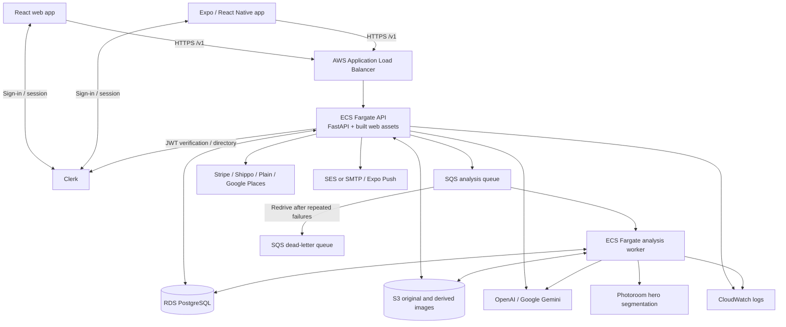

# Jouft system architecture and third-party services

Updated: October 28, 2026.

Reader editions: [documentation home](index.html) ·
[styled architecture guide](system-architecture-guide.html).
Regenerate both with `python3 scripts/build_docs_site.py`; use `--check` to verify.
Standalone pages can be opened locally. Hosted integration is implemented at
`/docs/home`, `/docs/system-architecture` and `/docs/listing-analysis`; these serve
the sign-in shell only. HTML bytes require an administrator through matching
`/v1/admin/docs/*` endpoints. Hosted integration was deployed October 28, 2026,
release `afeb5a3`, workflow `40743473819`: migrations, API revision 183/worker
revision 53 stability and workflow smoke checks passed. Live shells returned 200,
unauthenticated document endpoints returned 401 and direct HTML URLs returned 404.
Admin rendering was verified in local API tests; a signed-in production browser
session was not exercised. This post-deploy status is versioned in Git; the
deployed guide contains the preceding deployment-pending status until its next rollout.

This document describes the implemented system, not a proposed redesign. Source
code and Terraform define the architecture; the deployment snapshot below records
what was verified separately. A configured credential does not prove that an
integration is healthy, receiving traffic or ready for public release.

For the authoritative analysis workflow, model handoffs, pricing evidence,
invalidation and publication rules, see [Listing analysis process](LISTING_ANALYSIS_PROCESS.md).
For endpoint contracts, see [API](API.md).

## 1. System overview

Jouft is a web and mobile marketplace for creating, valuing and trading fashion
items. The backend is a modular Python application rather than independently
deployed microservices. HTTP requests run in an API service; long-running listing
analysis runs in a separate worker service built from the same container image.
An AI assistant selects application tools, while backend code enforces ownership,
validation, matching policy and approval requirements.

External arrows represent implemented integration paths, not a guarantee that
every path runs for every request. Notification helpers may also execute from
worker/background paths. Optional legacy valuation providers are listed separately.

## 2. Applications and shared packages

| Component | Implementation and responsibility | Main source |
| --- | --- | --- |
| Web | React 19 + Vite; marketplace, closet, assistant threads, review, trades and account UI | `apps/web/src/App.jsx` |
| Mobile | Expo SDK 54 / React Native; native image selection, assistant, marketplace, payments, sharing and push registration | `apps/mobile/App.js`, `app.config.js`, `config/variants.cjs` |
| Shared client | API transport, conversation/listing state controllers and shared photo/review helpers; not a separate hosted service | `packages/app-client/src/` |
| HTTP API | FastAPI/Uvicorn; authentication, listing/trade/account operations, uploads, webhooks, tool execution and static web delivery | `apps/api/app/main.py`, `auth.py`, `deps.py` |
| Assistant | Parent conversation state, context resolution, read tools and child listing sessions; bounded model/tool turns | `assistant_conversation_routes.py`, `assistant_reads.py`, `assistant_read_agent.py`, `listing_agent.py`, `listing_agent_routes.py` |
| Analysis worker | SQS polling, durable job execution/recovery and parallel component orchestration | `analysis_worker.py`, `analysis_execution.py`, `listing_pipeline.py`, `pipeline_results.py` |
| Image/identity/pricing | Evidence selection, product identification, source validation, pricing/model assignment and generated-image review | `gpt_item_profile.py`, `product_identity.py`, `pricing_evidence.py`, `pricing_sources.py`, `pricing_models.py`, `mannequin_fidelity.py` |
| Local analysis packages | Brand and condition image processing; optional comparable-provider valuation implementation | `packages/brand/`, `packages/condition/`, `packages/valuation/` |
| Persistence | PostgreSQL in AWS; SQLite available locally; application migrations and storage abstraction | `db.py`, `migrations.py`, `storage.py` |

Backend paths without a directory prefix in the table are under `apps/api/app/`.
Much business logic still resides in `main.py`; the module boundaries above are
logical boundaries, not network service boundaries.

## 3. Main request and data flows

### Authentication and authorization

1. Web/mobile obtain a Clerk session token and send it to the API.
2. Backend validates JWTs using configured issuer/JWKS/audience/authorized-party
   rules and resolves an authenticated principal.
3. Queries and mutations enforce owner/access checks in application code. The API
   also supports configured API-key authentication for applicable operational paths;
   it must not be treated as an end-user credential to distribute publicly.
4. Administrative checks and provider webhook validation remain backend concerns;
   model instructions or client-visible buttons are not authorization boundaries.

### Listing creation, analysis and publication

1. Original photos are uploaded and stored; listing/session facts and timeline
   state are persisted. Coverage checks identify required views and missing facts.
2. A version-bound user confirmation permits private draft creation and analysis,
   not publication. A durable job is queued for the worker when SQS is configured.
3. The worker freezes original evidence and runs independently checkpointed pricing,
   mannequin and optional background-cleanup components. Results merge with stale-
   input guards rather than overwriting unrelated edits.
4. Identification/pricing use original evidence. Photoroom receives only the selected
   original hero for a foreground mask; original product pixels are composited over
   white. Detail photos are unchanged. Failure retains the original, with no rembg
   or generative background fallback in this branch.
5. Mannequin generation is separate: Gemini generates/reviews a synthetic preview;
   owner review controls inclusion. It is not identity/pricing evidence.
6. Saved analysis and any manual-review requirement are presented to the owner.
   Publication requires its separate approval and current backend prerequisites.

The HTTP API is not expected to hold a request open for the entire analysis.
Clients read saved progress. Durable job/component state, retry recovery and the
SQS visibility/acknowledgment lifecycle coordinate execution; SQS delivery must
not be assumed to be exactly once.

### Matching and trading

Matches come from application-defined value/preference rules, not model-created
criteria. Selecting a result prepares an exact offered/requested item proposal.
Sending requires explicit confirmation. Active-request lookup and a database-scoped
sender/target lock protect normal/API/agent creation from concurrent duplicates.
The system can report an existing request rather than sending another one.
Trade/shipping/payment operations and notifications remain separate effects;
sending a proposal does not itself complete a trade or charge a payment.

### Storage and consistency

- PostgreSQL stores listings, image metadata, analyses/jobs/components, conversation
  state, operation/retry records, trade offers, account preferences and related
  payment/shipping/support/notification records.
- S3 stores binary uploads, generated/cleaned variants and debug artifacts. API image
  URLs resolve persisted image records to storage; the database is not the primary
  binary-image store.
- Gallery records distinguish original `p_img` from display `d_img`, preserving
  evidence independently of presentation variants.
- SQS carries work messages; PostgreSQL remains the durable application/job state.
- SQLite/local files provide a development alternative, not production-equivalent
  infrastructure or concurrency behavior.

## 4. AWS infrastructure and operations

Terraform definitions: [`infra/terraform/main.tf`](../infra/terraform/main.tf).

| AWS service/resource | Role |
| --- | --- |
| VPC, public/private subnets, route tables, Internet Gateway, security groups | Network isolation and ingress/egress. Terraform assigns public IPs to ECS tasks; RDS is not publicly accessible. Do not assume a private-task/NAT design. |
| Application Load Balancer | Routes public requests to API targets; HTTPS listener uses a supplied certificate, with HTTP behavior controlled by certificate configuration. |
| ACM certificate / Route 53 | TLS certificate reference and configured API DNS alias; certificate/domain setup is partly supplied configuration, not all created by this stack. |
| ECS Fargate | Separate API and analysis-worker services, ARM64 task definitions; worker runs `python -m app.analysis_worker`. |
| Application Auto Scaling / CloudWatch metrics | API CPU/memory scaling; worker queue-depth/oldest-message scaling. Effective counts depend on environment settings. |
| ECR | Versioned application image shared by API and worker. |
| RDS PostgreSQL 16 | Relational persistence, configured backup retention/Multi-AZ choices and private DB networking. |
| S3 | Private upload bucket with public-access blocking, versioning, CORS and lifecycle rules. |
| SQS + DLQ | Analysis delivery and failed-message retention/redrive. Terraform configures four-day main queue retention and fourteen-day DLQ retention. |
| IAM | Execution/task roles and scoped storage, queue and email permissions. |
| Secrets Manager (optional path) | Runtime secret injection when a secret ARN is configured. Other runtime settings/secrets may be task environment entries; do not assume all secrets use Secrets Manager. |
| CloudWatch Logs | API/worker structured application logs; Terraform log retention is fourteen days. |
| SES | Transactional email transport; an SMTP alternative also exists. |

The Docker build compiles Vite assets and copies them into the Python image. The
API serves the built frontend; this repository's primary deployment does not define
a separate CloudFront/Vercel/Netlify frontend, Kubernetes cluster, Redis or Celery.

Production deploys through GitHub Actions: build/push image, run database migrations
before application replacement, update API/worker, wait stable and run smoke checks.
Full Terraform apply is optional for infrastructure changes. The guarded staging
script supports existing-stack rollout and service-definition rollback on failure;
this must not be generalized into a claim of automatic production rollback.
Database migrations are not automatically undone by a service rollback.

The production-health workflow is scheduled every five minutes, with dependency
checks and configured alert transports. A workflow schedule is not an uptime SLA.

## 5. Third-party service inventory

Status legend: **Configured** means credential/flag presence was observed in the
production API task definition on October 28; it does not prove a successful live
transaction. **Implemented** means an integration path exists in source.
**Optional/legacy** means it is gated, disabled or not verified as active.

| Provider/service | Purpose and data crossing the boundary | Configuration/status and implementation |
| --- | --- | --- |
| OpenAI API | Assistant intent/tool selection, listing reasoning/identification/pricing and selected image checks. Receives prompts, relevant conversation/context, item facts and selected images depending on operation. | Configured. `OPENAI_API_KEY`; assistant and pricing routing enabled. `listing_agent.py`, `assistant_read_agent.py`, `gpt_item_profile.py`, `main.py`. Model names are runtime settings, not a universal single-model architecture. |
| Google Gemini API | Image understanding, identity/price research paths and separate mannequin generation/review. Receives selected item photos, facts and prompts; research may use provider grounding. | Configured. `GEMINI_API_KEY`; `gpt_item_profile.py`, `mannequin_fidelity.py`, `main.py`. |
| Google Cloud Vertex AI / search | Optional Vertex/search paths and Google-auth-based access. Inputs depend on the enabled image/search path. | Optional; `GCP_PROJECT_ID`, location and `GPT_ITEM_PROFILE_VERTEX_SEARCH_*`. Source support is not proof of a configured project/datastore. |
| Photoroom | Hero foreground segmentation; receives the selected hero image, returns a mask-bearing image. Account endpoint supports health probing. | Configured and enabled in production release `c927955`. `PHOTOROOM_API_KEY`; `_stage_item_image` / `_run_listing_image_staging_job` in `main.py`. No real production image request was made during rollout verification. |
| Clerk | Sign-in/session/JWT infrastructure, user directory/admin access. Receives account/authentication information; API verifies tokens and may query directory data. | Configured/enabled. Frontend publishable keys; backend `CLERK_*`. `auth.py`, web/mobile Clerk SDKs. Production app environment and Clerk instance mode are distinct concepts. |
| Stripe | Customer/payment-method setup, checkout/subscriptions, payment-related webhooks; native/web SDKs tokenize payment details. | Configured. `STRIPE_SECRET_KEY`, publishable key and webhook secret. `main.py`, Stripe.js, mobile Stripe SDK. Configuration does not establish App Store billing compliance. |
| Apple Pay / Google Pay | Wallet presentation through Stripe; wallet/payment tokens pass through payment SDK/provider paths. | Implemented mobile payment configuration. Apple merchant `merchant.com.jouft.app`; Apple/Google account setup and eligibility still matter. Not equivalent to Apple In-App Purchase. |
| Shippo | Shipment/rate/label/tracking operations; receives shipping addresses, parcel/contact information and trade/shipment context. | Configured. `SHIPPO_API_KEY`, API base/contact/parcel settings; `main.py`. Carrier services (including USPS rates) may be reached through Shippo. |
| USPS Addresses API | Direct address validation, separate from USPS carrier use through Shippo. Receives address fields. | Implemented but `USPS_BEARER_TOKEN` absent in inspected task. `USPS_*`; `main.py`. |
| Google Places API | Address autocomplete/details; receives address search text, place identifiers and request metadata. | Configured. `GOOGLE_PLACES_API_KEY`, optional iOS bundle restriction setting; `main.py`. |
| Google Maps | Contact-map embed and directions links; browser/device navigation can expose query/location and standard request metadata to Google. | Implemented web/mobile UI links; distinct from Places API. |
| Plain | Support customer/thread creation and webhook synchronization; receives account/contact data and submitted support/listing context. | Configured. `PLAIN_API_KEY`, API URL and webhook secret; `main.py`. |
| Amazon SES / SMTP host | Transactional/support/admin emails; receives recipients and message content, potentially shipping or trade details. | Production `EMAIL_PROVIDER=ses`. `SES_*`, sender/template settings; SMTP is an implemented configurable alternative, not a named additional active vendor. |
| Expo Push Service → APNs / FCM | Mobile push delivery; device/Expo push tokens and notification payloads cross provider boundaries. | Implemented and default-enabled; device registration, platform credentials and delivery must be verified separately. `EXPO_PUSH_*`, `expo-notifications`, `main.py`. |
| Expo EAS | Native cloud builds and store submission; uploads application source/build configuration and uses signing/distribution credentials. | Build/submit profiles in `apps/mobile/eas.json`; EAS environments and scripts. Not the primary API hosting provider; no OTA update channel is configured here. |
| Apple Developer / App Store Connect / TestFlight | iOS identifiers, signing, build distribution and review. Receives binaries, store metadata and testing/review information. | Production record `6826942359`; testing record `6791465341`. Creating a record is not App Review approval or public release. |
| Google Play / Android distribution | Android store distribution target and native platform services; EAS can also distribute an APK directly. | Production profile emits AAB; staging emits APK. Google Play release/account readiness not verified by this document. |
| GitHub / GitHub Actions | Source/version history, CI tests, image builds, deployment and health automation. Receives repository contents and configured CI secrets/artifacts/logs. | `.github/workflows/`; production workflow uses AWS credentials to publish and deploy. |
| Facebook / Meta | User-initiated listing share URL/composer handoff; exposes shared public URL/caption and browser/app context. Social sign-in is mediated by Clerk when configured. | Implemented sharing. iOS uses Facebook web sharing; Android targets native sharing. No automatic personal-profile publishing API or native iOS Meta SDK composer is established. |
| Instagram Graph API | Configuration fields exist for user ID/token/version. | No active API implementation found in `main.py`; token absent in inspected task. Do not describe as an operational posting integration. |
| PayPal | Client-ID configuration field exists. | No implemented PayPal transaction flow found in `main.py`; client ID absent. Not an active payment provider claim. |
| Firecrawl | Optional comparable-provider page extraction/search transport; receives target URLs/search queries. | Legacy/optional valuation path in `packages/valuation`; `FIRECRAWL_*`. Production comparable-provider engine disabled in inspected settings. |
| eBay API | Optional legacy sold-comparable provider; receives item search criteria. | `EBAY_APP_ID`; `packages/valuation/.../providers/ebay.py`. Not the same as AI research of public eBay pages; engine disabled in inspected production settings. |

### Pricing information websites are not necessarily API integrations

The primary approved resale-source policy lists The RealReal, Poshmark, Vestiaire
Collective, Rebag, Depop, Vinted and eBay (with explicitly listed regional domains).
Official brand domains are separately allowlisted for identity/specifications and
retail reference, not resale anchors. The complete maintained lists live in
`apps/api/app/pricing_sources.py`; those lists are authoritative over this summary.

These are evidence sources that model/provider research may consult, not evidence
of licensed feeds, commercial contracts, working direct APIs or sold-price access.
The legacy valuation provider registry additionally contains brand-site, Poshmark,
The RealReal and Rebag HTTP/crawler paths and a stub. Its broader site heuristics
must not be confused with the primary approved-source policy. TRUSS is not present
in the inspected approved-source policy or provider registry.

Open-source libraries (React, FastAPI, Pillow, OpenCV, boto3, psycopg, PyJWT,
rembg, etc.) are software dependencies, not separately hosted third-party services.
Their manifests remain the inventory for dependency/security/license review.

## 6. Environments and deployment snapshot

| Environment | Application/data boundary | Distribution |
| --- | --- | --- |
| Local/development | Local API, SQLite/local files by default; optional configured services | Expo development client/simulator; testing app identity |
| Staging | `https://staging.jouft.com`; separate `valueai-staging-*` ECS/RDS/S3/SQS resources and Terraform state | EAS preview; Jouft Testing, `com.jouft.app.dev` |
| Production | API `https://api.jouft.com`; production `valueai-mvp-*` stack; public application URL is configured separately | EAS production; JOUFT, `com.jouft.app` |

Development and staging share the testing identity and replace one another on a
device. The production identity is separate. Sharing an Apple Developer team or
EAS project does not mean sharing backend databases. Backend, web build-time,
mobile build-time and identity-provider settings must be aligned independently.

Verified production release on October 27: `c927955`, workflow `40625671003`, API
task revision 182 and worker revision 52. A read-only task-definition inspection on
October 28 still found the API revision/image above. It confirmed Clerk, assistant
conversations, listing agent, pricing routing and Photoroom enabled; controlled
research and the legacy comparable-provider engine disabled. The configured legacy
provider list is therefore not evidence those crawlers are currently running.

The staging release was verified October 25 at source `ec13811`; this document
does not claim the later hero-cleanup production release has also reached staging.
Mobile production record wiring is locally configured; this is not a verification
of a new production binary, live Clerk migration or App Store approval.

## 7. Security, privacy and operational considerations

- Never commit tokens, raw task definitions, Terraform state/tfvars containing
  secrets, signing keys or provider request dumps into architecture documentation.
  Examples list variable names only.
- Photos and conversation context can leave AWS for AI providers; addresses/contact
  data can leave for shipping, support and email providers. User disclosures,
  consent, retention and deletion behavior require their own review; this document
  does not assert compliance or vendor retention guarantees.
- Provider credentials belong server-side except intentionally publishable client
  configuration. EAS environments and CI secrets need environment separation too.
- AI tool outputs cannot bypass ownership checks, predefined matching logic,
  evidence validation, version-bound approvals or persisted-operation recovery.
- Preserve originals and never use generated presentation assets as item evidence.
- Investigate failed jobs/DLQ entries, stale pipeline merges and provider failures
  using saved state and structured logs. Avoid logging credentials or unnecessary
  personal data.
- App Store blockers previously identified (account deletion, Apple login, digital
  subscription billing and moderation) are not resolved merely by separating app
  identities or enabling Apple capabilities.

## 8. Maintenance and source map

Update this document when adding/removing a service, changing a deployment/data
boundary or enabling a previously optional integration. Recheck runtime settings
before labeling a service active. Provider-health and transaction tests are separate
from configuration inspection. Documentation-only updates do not authorize deployments.

- [AWS deployment](DEPLOY_AWS.md), [staging operations](../infra/terraform/STAGING.md)
- [Database migrations](DATABASE_MIGRATIONS.md)
- [Mobile build profiles](../apps/mobile/README.md)
- [Runtime settings](../apps/api/app/settings.py)
- [Production rollout workflow](../.github/workflows/deploy-prod.yml)
- [Production health workflow](../.github/workflows/production-health.yml)
- [Container build](../apps/api/Dockerfile)
- [Terraform resources](../infra/terraform/main.tf)
- [Canonical analysis workflow](LISTING_ANALYSIS_PROCESS.md)
